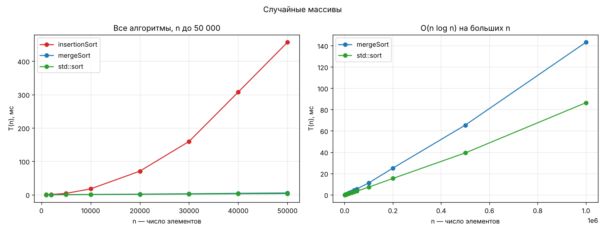
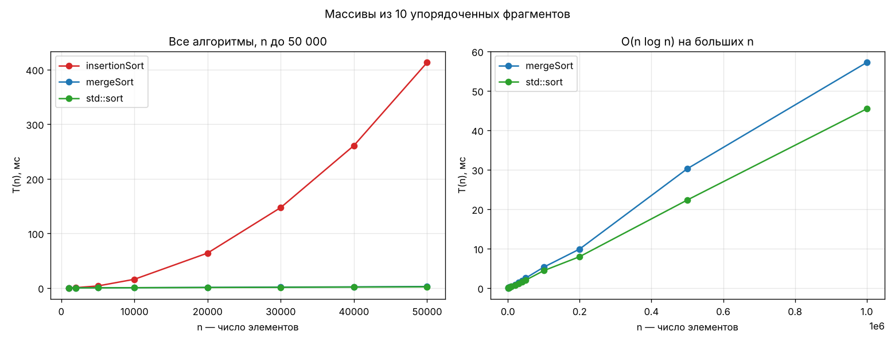

# Лабораторная: анализ сложности алгоритмов

Продолжение практик `Alg3` (простые сортировки) и `Alg4` (слияние, Хоар,
пирамида). Взяты те же алгоритмы и тот же код, но функции сделаны
**шаблонными** и запускаются на больших массивах с замером времени.

| Пункт задания | Что сделано |
|---|---|
| 1. Сортировка O(n²) шаблоном | `insertionSort` — сортировка вставками (из `Alg3`) |
| 2. Сортировка O(n log n) шаблоном | `mergeSort` + `mergeSortRange` — сортировка слиянием (из `Alg4`) |
| 3. Программа замера среднего времени + `std::sort` | `measure`, `runTests`, `main` в `Alg5.cpp` |
| 4. Случайные массивы | `fillRandom` |
| 5. Массивы с упорядоченными фрагментами | `fillFragments` (10 отсортированных кусков) |
| 6. Графики T(n) | `results/T_n_*.png`, данные в `results/results.csv` |
| 7. Схемы в UMLet | `uml/insertionSort.uxf`, `uml/mergeSort.uxf` |

## Как запустить

1. Открыть `Alg5.slnx` в Visual Studio.
2. **Сверху выбрать конфигурацию `Release`** (не Debug!). В Debug нет
   оптимизации, и время получается в разы больше и не показательно.
3. Запустить (Ctrl+F5). Программа печатает таблицы и записывает
   `results.csv` в папку проекта. Работает около полуминуты.
4. Графики: `python plot.py` в папке с `results.csv` (нужен
   `pip install matplotlib`). Можно и в Excel: открыть `results.csv`
   (разделитель `;`), выделить столбцы и вставить точечную диаграмму.

## Разбор кода

### insertionSort — сортировка вставками, O(n²)

```cpp
template <typename T>
void insertionSort(T arr[], int size) {
    for (int i = 1; i < size; i++) {
        T n = arr[i];                        // берём очередной элемент
        int j = i - 1;
        while (j >= 0 && n < arr[j]) {       // пока слева стоит больший
            arr[j + 1] = arr[j];             // сдвигаем его вправо
            j--;
        }
        arr[j + 1] = n;                      // ставим элемент на место
    }
}
```

Идея: левая часть `arr[0..i-1]` всегда отсортирована. Берём `arr[i]` и
сдвигаем больших соседей вправо, пока не найдём ему место.

**Почему O(n²).** Для элемента `arr[i]` внутренний цикл делает до `i`
сдвигов. В худшем случае (массив по убыванию) сдвигов
1 + 2 + … + (n−1) = n(n−1)/2 ≈ n²/2. На случайном массиве каждый элемент
в среднем уходит на половину пути, получается ≈ n²/4. Константа 1/4
в O-нотации отбрасывается, остаётся **O(n²)**.

Лучший случай — массив уже отсортирован: `while` сразу завершается,
всего n−1 сравнение, то есть **O(n)**.

### mergeSort — сортировка слиянием, O(n log n)

```cpp
template <typename T>
void mergeSortRange(T arr[], T buf[], int left, int right) {
    if (right - left <= 1) return;                 // 0 или 1 элемент — уже отсортирован

    int center = (right - left) / 2 + left;        // середина

    mergeSortRange(arr, buf, left, center);        // сортируем левую половину
    mergeSortRange(arr, buf, center, right);       // сортируем правую половину

    int i = left;                                  // указатель в левой половине
    int j = center;                                // указатель в правой половине

    for (int k = left; k < right; k++) {           // слияние в buf
        if (j == right || (i < center && arr[i] <= arr[j])) {
            buf[k] = arr[i++];                     // берём из левой
        }
        else buf[k] = arr[j++];                    // берём из правой
    }

    for (int k = left; k < right; k++) {           // копируем обратно
        arr[k] = buf[k];
    }
}

template <typename T>
void mergeSort(T arr[], int size) {
    T* buf = new T[size];                          // буфер один на всю сортировку
    mergeSortRange(arr, buf, 0, size);
    delete[] buf;
}
```

Полуинтервал `[left, right)`: `left` входит, `right` — нет.

Условие `j == right || (i < center && arr[i] <= arr[j])` читается так:
берём из левой половины, если правая закончилась **или** левая ещё не
закончилась и её элемент не больше. Знак `<=` (а не `<`) делает
сортировку **устойчивой**: равные элементы сохраняют исходный порядок.

`center = (right - left) / 2 + left`, а не `(left + right) / 2`, чтобы
сумма не переполнила `int` на очень больших индексах.

**Почему O(n log n).** Массив делится пополам, пока куски не станут по
1 элементу: это log₂n уровней рекурсии. На каждом уровне все слияния
вместе проходят по всем n элементам один раз. Итого n · log₂n.
Формально: T(n) = 2·T(n/2) + c·n, по основной теореме T(n) = O(n log n).
Причём в любом случае, даже в худшем.

Дополнительная память — буфер на n элементов, **O(n)**.

### std::sort

В Visual Studio и в gcc это **интроспективная сортировка (introsort)**:
быстрая сортировка (как Хоар из `Alg4`). Если рекурсия становится
слишком глубокой, она переключается на пирамидальную (как `heapSort` из
`Alg4`), а маленькие куски досортировывает вставками. Стандарт C++
гарантирует **O(n log n)**.

### Почему функции шаблонные

`template <typename T>` — функция пишется один раз, а компилятор сам
создаёт версию для нужного типа. В начале `main` это показано:
`insertionSort` сортирует `int[]`, а `mergeSort` — `double[]`. Подойдёт
любой тип, у которого есть операторы `<` и `<=` (например, `string`).

Чтобы передать шаблон в `measure` как указатель на функцию, тип
указываем явно: `insertionSort<int>`.

### Как устроен замер

```cpp
double measure(void (*sortFunc)(int[], int), int src[], int arr[], int size)
```

* `sortFunc` — указатель на функцию сортировки, чтобы один код мерил все
  три алгоритма одинаково.
* `src` — исходный массив, `arr` — его копия. Сортируем копию, поэтому
  все три алгоритма получают **одинаковые** данные. Копирование в замер
  не входит.
* Время — `chrono::steady_clock`. `clock()` из `Alg1` в Windows меряет
  с шагом около 1 мс, а сортировка 1000 элементов идёт около 0.1 мс,
  поэтому `clock()` показал бы 0.
* После сортировки `isSorted` проверяет результат: если алгоритм
  ошибся, программа сообщит и остановится.

`runTests` для каждого n генерирует `TESTS = 10` разных массивов,
меряет все три алгоритма и делит сумму на 10 — это и есть **среднее
время**. `insertionSort` после n = 50 000 не запускается
(`MAX_N2`): на миллионе элементов он считал бы минуты.

### Тестовые массивы

* `fillRandom` — п. 4: каждый элемент `rand()`.
* `fillFragments` — п. 5: заполняем случайно, делим на `PARTS = 10`
  кусков и сортируем каждый кусок. Получается 10 упорядоченных
  фрагментов, а между собой они перемешаны.

## Результаты

Среднее время, мс, 10 массивов на каждое n. Конфигурация с оптимизацией
(`-O2`, аналог Release). На вашем компьютере цифры будут другие, но
соотношения — такие же.

### Случайные массивы

| n | insertionSort | mergeSort | std::sort |
|---:|---:|---:|---:|
| 1 000 | 0.186 | 0.084 | 0.047 |
| 5 000 | 4.132 | 0.421 | 0.267 |
| 10 000 | 17.572 | 0.923 | 0.593 |
| 20 000 | 70.689 | 1.909 | 1.234 |
| 30 000 | 159.587 | 2.985 | 1.934 |
| 40 000 | 307.551 | 4.326 | 2.786 |
| 50 000 | 456.697 | 5.413 | 3.362 |
| 100 000 | — | 11.115 | 7.167 |
| 500 000 | — | 65.418 | 39.309 |
| 1 000 000 | — | 143.199 | 86.463 |



### Массивы из 10 упорядоченных фрагментов

| n | insertionSort | mergeSort | std::sort |
|---:|---:|---:|---:|
| 1 000 | 0.152 | 0.040 | 0.033 |
| 5 000 | 3.598 | 0.219 | 0.173 |
| 10 000 | 15.847 | 0.470 | 0.389 |
| 20 000 | 63.847 | 0.918 | 0.756 |
| 30 000 | 147.242 | 1.466 | 1.133 |
| 40 000 | 260.767 | 1.872 | 1.555 |
| 50 000 | 412.889 | 2.547 | 2.021 |
| 100 000 | — | 5.295 | 4.405 |
| 500 000 | — | 30.248 | 22.316 |
| 1 000 000 | — | 57.178 | 45.433 |




## Выводы

1. **Рост O(n²) подтверждается.** При удвоении n время insertionSort
   растёт примерно в 4 раза: 10 000 → 20 000 даёт 17.6 → 70.7 мс (×4.0).
   На графике это парабола.
2. **Рост O(n log n) подтверждается.** При удвоении n время растёт чуть
   больше чем в 2 раза: 500 000 → 1 000 000 даёт для mergeSort ×2.19,
   для std::sort ×2.2. Теория: 2 · log(10⁶) / log(5·10⁵) ≈ 2.1. На
   графике почти прямая линия.
3. **Разница огромная.** На 50 000 элементах insertionSort медленнее
   mergeSort в 84 раза, а std::sort — в 136 раз. И разрыв растёт с n.
   На маленьких массивах (1000) разница всего в 2–4 раза. Поэтому
   std::sort досортировывает маленькие куски именно вставками.
4. **std::sort быстрее нашей mergeSort примерно в 1.7 раза.** Сложность
   у них одинаковая, разница в константе: std::sort сортирует на месте,
   без буфера и без копирования `buf → arr` на каждом шаге.
5. **Упорядоченные фрагменты:**
   * insertionSort быстрее всего на ~10%. Внутри фрагментов порядок
     есть, но фрагменты перемешаны между собой. Элементу всё равно
     приходится сдвигаться через чужие фрагменты, поэтому остаётся
     ~90% работы, то есть O(n²).
   * mergeSort быстрее в 2.5 раза, std::sort — в 1.9 раза. Операций
     столько же (n log n), но когда сливаются куски из одного
     фрагмента, условие `arr[i] <= arr[j]` выполняется подряд много
     раз. Процессор угадывает ветвление и работает быстрее.

**Итог:** для больших массивов выбор алгоритма важнее любой
оптимизации кода. O(n²) годится только для маленьких или почти
отсортированных массивов. На практике лучше использовать `std::sort`.

## Возможные вопросы на защите

**Почему выбрали вставки, а не пузырёк?** Оба O(n²), но вставки на
практике быстрее: не делают обменов, только сдвиги, и на почти
отсортированных данных работают за O(n).

**Почему слияние, а не Хоар?** Хоар в худшем случае O(n²) (при неудачном
опорном элементе), а слияние — всегда O(n log n). Плата — O(n)
дополнительной памяти.

**Что такое O-нотация?** Оценка роста времени при росте n. Константы и
младшие слагаемые отбрасываются: n²/4 + n → O(n²).

**Почему время не ровно ×4 / ×2?** Мешают кэш процессора, другие
программы и погрешность таймера. Поэтому берём среднее по 10 запускам.

**Зачем копировать массив перед сортировкой?** Иначе второй алгоритм
получил бы уже отсортированный массив, и сравнение было бы нечестным.

**Зачем `isSorted`?** Чтобы доказать, что сортировка правильная, а не
просто быстрая.

**Почему Release?** В Debug компилятор не оптимизирует код и добавляет
проверки. Время получается в разы больше и искажает сравнение.

## Схемы алгоритмов

`uml/insertionSort.uxf` и `uml/mergeSort.uxf` открываются в UMLet
(File → Open). Картинка для отчёта: File → Export as → PNG.
