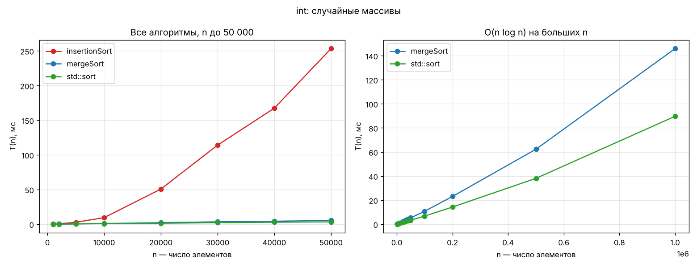
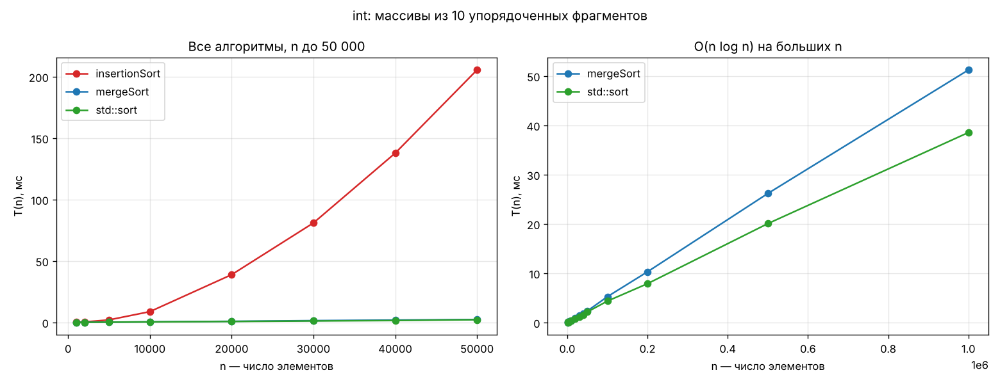
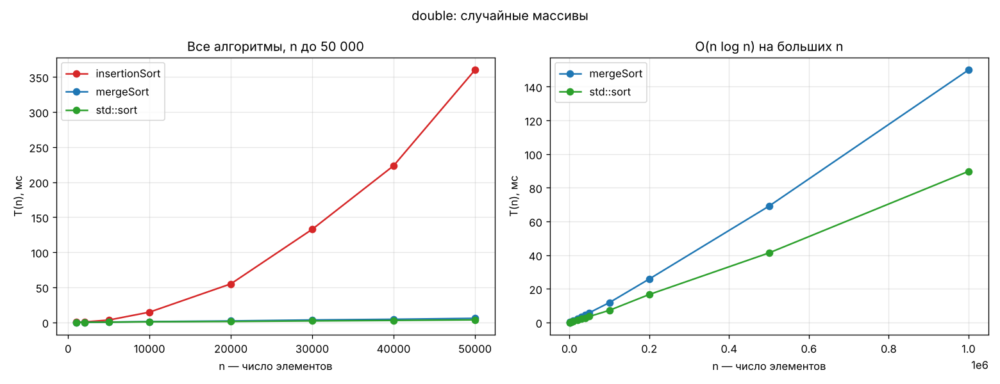
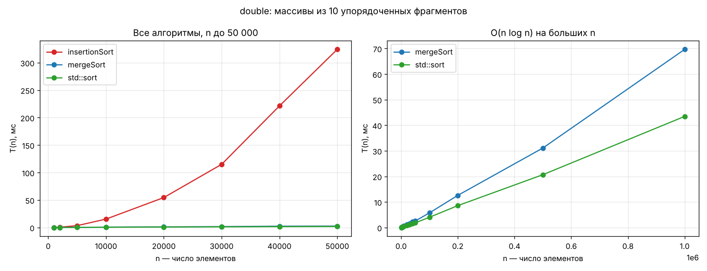
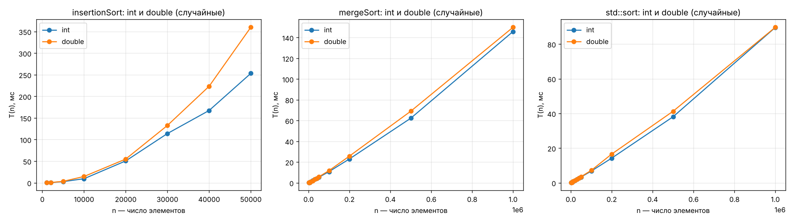
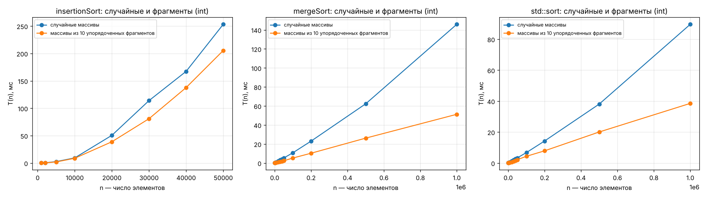

# Лабораторная: анализ сложности алгоритмов

Продолжение практик `Alg3` (простые сортировки) и `Alg4` (слияние, Хоар,
пирамида). Взяты те же алгоритмы и тот же код, но **все функции сделаны
шаблонными** и запускаются на больших массивах `int` и `double` с замером
времени.

| Пункт задания | Что сделано |
|---|---|
| 1. Сортировка O(n²) шаблоном | `insertionSort` — сортировка вставками (из `Alg3`) |
| 2. Сортировка O(n log n) шаблоном | `mergeSort` + `mergeSortRange` — сортировка слиянием (из `Alg4`) |
| 3. Программа замера среднего времени + `std::sort` | `measure`, `runTests`, `runAll`, `main` в `Alg5.cpp` |
| 4. Случайные массивы | `fillRandom` |
| 5. Массивы с упорядоченными фрагментами | `fillFragments` (10 отсортированных кусков) |
| 6. Графики T(n) | `results/T_n_*.png`, данные в `results/results.csv` |
| 7. Схемы алгоритмов в UMLet | `uml/insertionSort.uxf`, `uml/mergeSort.uxf` — блок-схемы по ГОСТ 19.701-90 |

Все замеры делаются для двух типов элементов: **int** и **double**.

## Как запустить

1. Открыть `Alg5.slnx` в Visual Studio.
2. **Сверху выбрать конфигурацию `Release`** (не Debug!).
3. Запустить (Ctrl+F5). Программа печатает таблицы и записывает
   `results.csv` в папку проекта (около минуты).
4. Таблицы и графики в Google Colab: загрузить `results.csv`, запустить
   `show_csv.py` (таблицы) и `plot.py` (графики).

## Что в коде

* `insertionSort<T>`, `mergeSort<T>` / `mergeSortRange<T>`, `stdSort<T>` — три сортировки.
* `fillRandom<T>` — случайные числа. Для `double` получается дробное число
  (`rand() + rand() / RAND_MAX`, например 12345.678), для `int` дробная часть
  отбрасывается.
* `fillFragments<T>` — массив из 10 отсортированных кусков.
* `isSorted<T>`, `printArray<T>` — проверка и печать.
* `measure<T>` — время одной сортировки (копия массива → таймер → сортировка → проверка).
* `runTests<T>` — среднее время трёх сортировок по 10 массивам одного размера.
* `runAll<T>` — все размеры для одного типа: сначала случайные, потом фрагменты.
* `main` — демонстрация шаблонов, затем `runAll<int>` и `runAll<double>`.

Подробно каждая функция разобрана в `Alg5_explanation.pdf`, короткие
ответы «что делает / как делает» — в `Alg5_cheatsheet.pdf`.

## Результаты

Среднее время, мс, 10 массивов на каждое n, сборка с оптимизацией. На
другом компьютере цифры будут другими, но соотношения сохранятся.

### int, случайные массивы

| n | insertionSort | mergeSort | std::sort |
|---:|---:|---:|---:|
| 1 000 | 0.145 | 0.116 | 0.050 |
| 2 000 | 0.459 | 0.153 | 0.106 |
| 5 000 | 2.626 | 0.434 | 0.278 |
| 10 000 | 9.405 | 0.921 | 0.695 |
| 20 000 | 50.579 | 2.101 | 1.298 |
| 30 000 | 113.970 | 3.377 | 2.134 |
| 40 000 | 167.345 | 4.231 | 2.764 |
| 50 000 | 253.223 | 5.277 | 3.326 |
| 100 000 | — | 10.757 | 6.738 |
| 200 000 | — | 23.025 | 14.234 |
| 500 000 | — | 62.282 | 38.090 |
| 1 000 000 | — | 145.876 | 89.627 |

### int, массивы из 10 упорядоченных фрагментов

| n | insertionSort | mergeSort | std::sort |
|---:|---:|---:|---:|
| 1 000 | 0.141 | 0.047 | 0.040 |
| 2 000 | 0.366 | 0.079 | 0.065 |
| 5 000 | 2.007 | 0.202 | 0.159 |
| 10 000 | 8.727 | 0.418 | 0.350 |
| 20 000 | 38.837 | 0.872 | 0.730 |
| 30 000 | 80.940 | 1.440 | 1.151 |
| 40 000 | 137.759 | 1.858 | 1.495 |
| 50 000 | 205.447 | 2.340 | 2.146 |
| 100 000 | — | 5.240 | 4.342 |
| 200 000 | — | 10.291 | 7.879 |
| 500 000 | — | 26.171 | 20.058 |
| 1 000 000 | — | 51.225 | 38.533 |

### double, случайные массивы

| n | insertionSort | mergeSort | std::sort |
|---:|---:|---:|---:|
| 1 000 | 0.172 | 0.088 | 0.055 |
| 2 000 | 0.574 | 0.158 | 0.099 |
| 5 000 | 3.295 | 0.415 | 0.267 |
| 10 000 | 14.571 | 1.057 | 0.836 |
| 20 000 | 54.904 | 2.030 | 1.279 |
| 30 000 | 132.724 | 3.420 | 2.046 |
| 40 000 | 223.393 | 4.396 | 2.725 |
| 50 000 | 360.000 | 5.760 | 3.530 |
| 100 000 | — | 11.735 | 7.156 |
| 200 000 | — | 25.762 | 16.572 |
| 500 000 | — | 69.038 | 41.264 |
| 1 000 000 | — | 149.935 | 89.718 |

### double, массивы из 10 упорядоченных фрагментов

| n | insertionSort | mergeSort | std::sort |
|---:|---:|---:|---:|
| 1 000 | 0.127 | 0.042 | 0.032 |
| 2 000 | 0.503 | 0.085 | 0.064 |
| 5 000 | 3.344 | 0.242 | 0.175 |
| 10 000 | 15.291 | 0.603 | 0.441 |
| 20 000 | 54.484 | 1.135 | 0.857 |
| 30 000 | 114.943 | 1.627 | 1.175 |
| 40 000 | 221.276 | 2.332 | 1.584 |
| 50 000 | 324.173 | 2.573 | 1.840 |
| 100 000 | — | 5.731 | 4.025 |
| 200 000 | — | 12.581 | 8.564 |
| 500 000 | — | 31.093 | 20.669 |
| 1 000 000 | — | 69.658 | 43.454 |

## Выводы

1. **O(n²) подтверждается.** При удвоении n время insertionSort растёт
   примерно в 4 раза: для double 10 000 → 20 000 даёт ×3.8,
   20 000 → 40 000 — ×4.1. Для int отдельные точки
   дают от ×3.3 до ×5.4 — это погрешность замера, в среднем ≈4.
2. **O(n log n) подтверждается.** 500 000 → 1 000 000: mergeSort
   ×2.34 (int) и ×2.17 (double), теория ≈2.1.
3. **Разница огромная.** При n = 50 000 insertionSort медленнее mergeSort
   в 48 раз (int) и 62 раз (double).
4. **std::sort быстрее нашей mergeSort в ~1.6 раза** — сложность одна,
   но std::sort работает без буфера и копирования.
5. **int и double.** Тип элементов не меняет порядок роста — графики имеют
   ту же форму. Меняется только константа: insertionSort на double медленнее
   в 1.4 раза (double занимает 8 байт вместо 4, а вставки
   постоянно двигают элементы в памяти). mergeSort и std::sort почти
   не замечают разницы (×1.03 и ×1.00).
6. **Упорядоченные фрагменты.** insertionSort ускоряется мало
   (на 19% для int) и остаётся O(n²); mergeSort ускоряется
   в 2.8 раза, std::sort — в 2.3 раза.

## Схемы алгоритмов

`uml/insertionSort.uxf` и `uml/mergeSort.uxf` — блок-схемы по ГОСТ 19.701-90,
открываются в UMLet (File → Open), картинка для отчёта: File → Export as → PNG.

* овал — начало / конец;
* прямоугольник — действие;
* ромб — условие, выходы «да» / «нет»;
* шестиугольник — цикл `for` (заголовок цикла);
* прямоугольник с двойными боковыми линиями — вызов функции (`mergeSortRange`).
