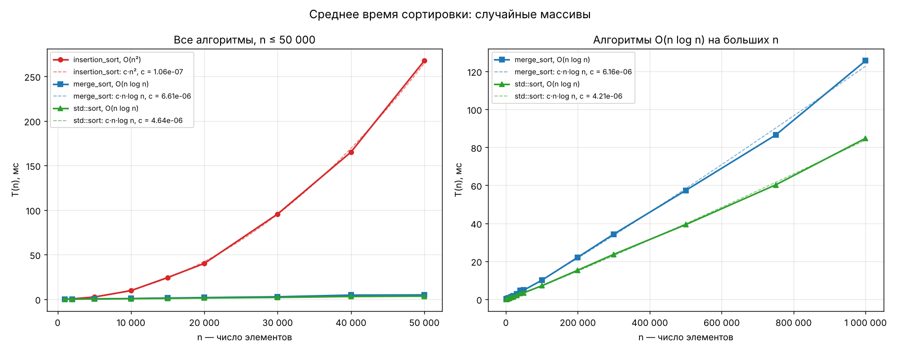
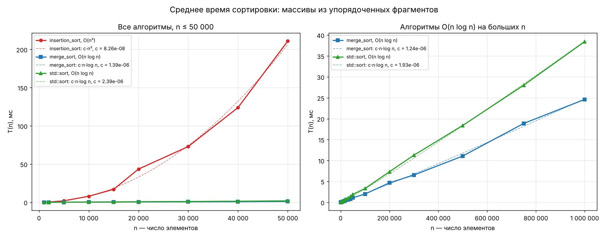
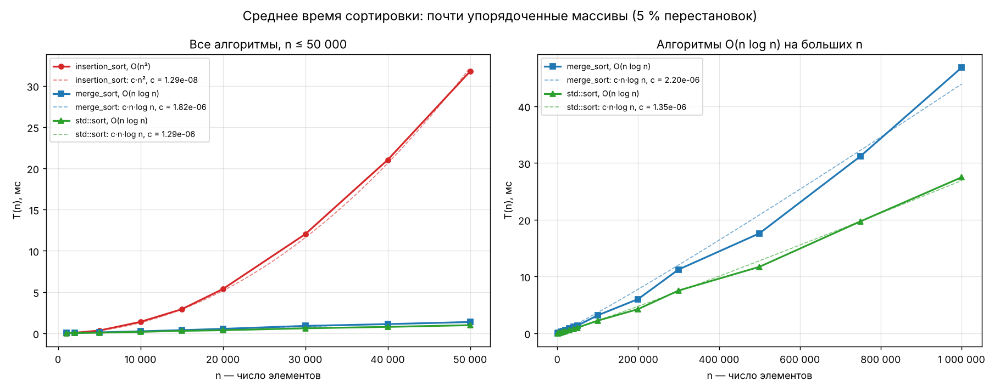
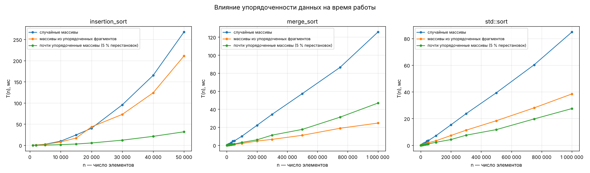
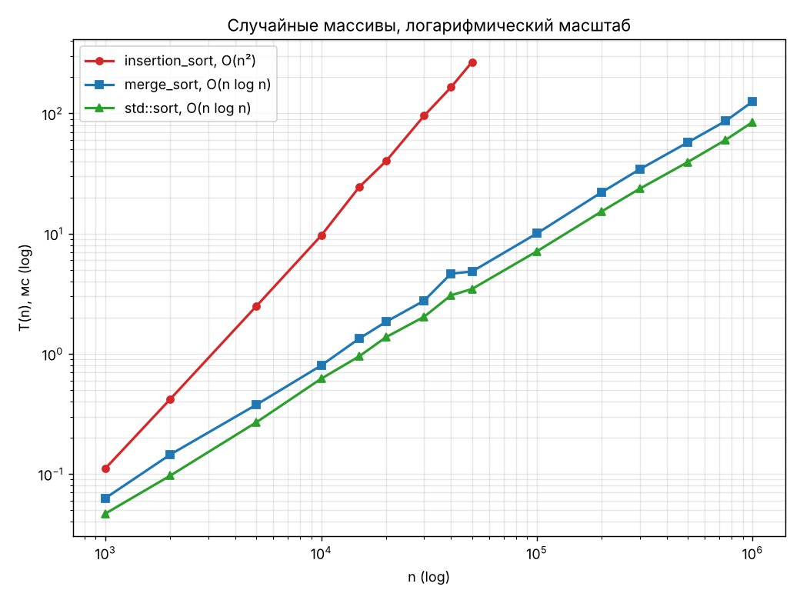

# Анализ сложности алгоритмов

Лабораторная работа: сравнение сортировки со сложностью O(n²), сортировки
со сложностью O(n log n) и стандартной `std::sort`.

| Пункт задания | Где сделано |
|---|---|
| 1. Сортировка O(n²) в виде шаблонной функции | `include/sorts.hpp` — `sorts::insertion_sort` (сортировка вставками) |
| 2. Сортировка O(n log n) в виде шаблонной функции | `include/sorts.hpp` — `sorts::merge_sort` (сортировка слиянием) |
| 3. Программа для замера среднего времени (вместе с `std::sort`) | `src/benchmark.cpp` |
| 4. Сравнение на случайных массивах | данные `random` |
| 5. Сравнение на массивах с упорядоченными фрагментами | данные `fragments` (+ дополнительно `nearly_sorted`) |
| 6. Графики T(n) | `plot.py` → `results/*.png` |
| 7. Схемы алгоритмов в UMLet | `uml/insertion_sort.uxf`, `uml/merge_sort.uxf` |

## Структура

```
sort_analysis/
├── include/sorts.hpp        шаблонные функции сортировки
├── src/benchmark.cpp        замер среднего времени, вывод в CSV
├── src/tests.cpp            проверка корректности сортировок
├── plot.py                  построение графиков T(n)
├── uml/                     схемы алгоритмов (открываются в UMLet)
├── results/                 результаты замеров и графики
└── CMakeLists.txt
```

## Сборка и запуск

Замеры нужно делать **с оптимизацией** (`-O2` / Release), иначе время
не показательно.

```bash
# g++ / clang
g++ -std=c++17 -O2 -Iinclude src/tests.cpp     -o tests
g++ -std=c++17 -O2 -Iinclude src/benchmark.cpp -o benchmark
./tests                      # проверка корректности
./benchmark results          # полный замер (~30 с), пишет results/results.csv
./benchmark results --quick  # быстрый прогон для проверки

# графики (нужен matplotlib: pip install matplotlib)
python plot.py results
```

Через CMake (в том числе Visual Studio):

```bash
cmake -S . -B build -DCMAKE_BUILD_TYPE=Release
cmake --build build --config Release
```

В Visual Studio можно также просто создать консольный проект, добавить
`src/benchmark.cpp` и `include/sorts.hpp`, выбрать конфигурацию **Release**.
Каталог `results` должен существовать до запуска.

## Реализованные алгоритмы

Обе функции имеют интерфейс как у `std::sort`: принимают итераторы
произвольного доступа и необязательный компаратор, поэтому работают с
`std::vector`, C-массивами, `std::deque`, с любыми типами (`int`, `double`,
`std::string`, свои структуры) и с любым порядком (`std::greater<>` и т. п.).

```cpp
std::vector<int> v{5, 2, 9, 1};
sorts::insertion_sort(v.begin(), v.end());
sorts::merge_sort(v.begin(), v.end(), std::greater<>{});
```

### Сортировка вставками — O(n²)

Массив делится на отсортированную часть `[0, i)` и неотсортированную.
Очередной элемент `a[i]` запоминается в `key` и сдвигается влево, пока
слева стоит больший элемент.

* худший и средний случай: ~n²/4 сравнений и сдвигов → **O(n²)**;
* лучший случай (массив уже отсортирован): n − 1 сравнение → **O(n)**;
* в общем случае время ~ n + I, где I — число инверсий в массиве;
* память O(1), сортировка устойчива.

### Сортировка слиянием — O(n log n)

Массив делится пополам, каждая половина сортируется рекурсивно, затем
половины сливаются в буфере.

* глубина рекурсии log₂ n, на каждом уровне слияние стоит O(n) →
  **O(n log n)** в любом случае: T(n) = 2T(n/2) + O(n);
* буфер на n элементов выделяется один раз на всю сортировку;
* если после сортировки половин `a[mid − 1] ≤ a[mid]`, слияние пропускается —
  на уже упорядоченных участках это даёт заметное ускорение;
* память O(n), сортировка устойчива.

### std::sort

В libstdc++ это интроспективная сортировка: быстрая сортировка + пирамидальная
(если рекурсия слишком глубокая) + вставки на маленьких отрезках. Гарантия
стандарта — O(n log n) сравнений.

## Методика эксперимента

* Для каждого размера n генерируется **10 разных массивов** `int`; каждый
  алгоритм сортирует *копию одного и того же* массива. В таблицах — среднее
  время по 10 запускам (в CSV также минимум и максимум).
* Время меряется `std::chrono::steady_clock`; копирование массива и проверка
  результата (`std::is_sorted`) в замер не входят.
* Генератор `std::mt19937` с фиксированным зерном — результаты воспроизводимы.
* n = 1 000 … 50 000 для всех алгоритмов, для O(n log n) дополнительно
  до 1 000 000 (сортировка вставками на миллионе элементов шла бы минуты).

Типы данных:

| Название | Как получен массив |
|---|---|
| `random` | случайные числа от 0 до 10⁹ |
| `fragments` | случайный массив разбит на 10 фрагментов случайной длины, каждый фрагмент отсортирован |
| `nearly_sorted` | отсортированный массив, в котором переставлено 5 % случайных пар (дополнительно) |

Компьютер: Linux x86-64, g++ 13.3, `-O2`. Полный вывод программы —
`results/console_output.txt`, данные — `results/results.csv`.

## Результаты

Среднее время, мс.

### Случайные массивы (п. 4)

| n | insertion_sort | merge_sort | std::sort |
|---:|---:|---:|---:|
| 1 000 | 0.111 | 0.063 | 0.047 |
| 5 000 | 2.483 | 0.376 | 0.268 |
| 10 000 | 9.623 | 0.798 | 0.620 |
| 20 000 | 40.122 | 1.846 | 1.375 |
| 30 000 | 95.597 | 2.763 | 2.031 |
| 40 000 | 165.081 | 4.645 | 3.067 |
| 50 000 | 267.507 | 4.829 | 3.457 |
| 100 000 | — | 10.029 | 7.118 |
| 500 000 | — | 57.325 | 39.319 |
| 1 000 000 | — | 125.608 | 84.792 |



### Массивы из упорядоченных фрагментов (п. 5)

| n | insertion_sort | merge_sort | std::sort |
|---:|---:|---:|---:|
| 1 000 | 0.091 | 0.023 | 0.030 |
| 5 000 | 1.944 | 0.100 | 0.158 |
| 10 000 | 7.908 | 0.206 | 0.325 |
| 20 000 | 43.417 | 0.477 | 0.779 |
| 30 000 | 72.911 | 0.610 | 1.017 |
| 40 000 | 123.880 | 0.823 | 1.411 |
| 50 000 | 210.886 | 1.078 | 1.903 |
| 100 000 | — | 1.995 | 3.313 |
| 500 000 | — | 11.059 | 18.372 |
| 1 000 000 | — | 24.613 | 38.434 |



### Почти упорядоченные массивы (дополнительно)

| n | insertion_sort | merge_sort | std::sort |
|---:|---:|---:|---:|
| 1 000 | 0.021 | 0.029 | 0.014 |
| 10 000 | 1.387 | 0.243 | 0.175 |
| 50 000 | 31.745 | 1.365 | 0.984 |
| 1 000 000 | — | 46.800 | 27.475 |



### Сводные графики (п. 6)





На графиках сплошная линия — измерения, пунктир — теоретическая кривая
c·n² или c·n·log n с коэффициентом c, подобранным методом наименьших
квадратов. Измерения хорошо ложатся на теоретические кривые.

## Анализ

**Порядок роста подтверждается экспериментом.**

* При увеличении n вдвое время сортировки вставками растёт в ~4 раза
  (20 000 → 40 000: 40.1 → 165.1 мс, ×4.1), как и должно быть для n².
* Для O(n log n) при удвоении n время растёт чуть больше чем в 2 раза
  (500 000 → 1 000 000: merge_sort ×2.19, std::sort ×2.16; теория
  2·log(10⁶)/log(5·10⁵) ≈ 2.1).
* Наклон прямых на log-log графике (n ≥ 5 000): insertion_sort ≈ 2.0,
  merge_sort и std::sort ≈ 1.05–1.1 (единица плюс небольшая добавка от log n).

**Случайные массивы.** Уже при n = 50 000 сортировка вставками медленнее
слияния в ~55 раз, и разрыв растёт пропорционально n / log n. Для маленьких
массивов (n ≈ 1 000) разница всего в 2 раза — поэтому `std::sort` и другие
библиотечные сортировки сортируют короткие отрезки именно вставками.
`std::sort` на случайных данных в ~1.45 раза быстрее нашей `merge_sort`:
она сортирует на месте, без буфера и лишних перемещений элементов.

**Упорядоченные фрагменты.** Все алгоритмы работают быстрее, чем на
случайных данных, но по-разному:

* insertion_sort — всего на ~20 % быстрее: время пропорционально числу
  инверсий, а при 10 фрагментах инверсий между фрагментами всё равно ~n²;
  сложность остаётся квадратичной;
* merge_sort — быстрее в ~5 раз и обгоняет `std::sort` в ~1.5 раза:
  внутри упорядоченных фрагментов срабатывает проверка
  `a[mid − 1] ≤ a[mid]`, и большинство слияний пропускается;
* std::sort — быстрее в ~2.2 раза, но использовать готовые упорядоченные
  участки так, как слияние, она не умеет.

**Почти упорядоченные массивы.** Сортировка вставками ускоряется в ~8 раз,
но остаётся квадратичной: случайные перестановки уносят элементы далеко от
своих мест, и каждый такой элемент сдвигается на O(n) позиций. Линейное
время сортировка вставками даёт, только когда каждый элемент стоит недалеко
от своего места.

**Выводы.**

1. Теоретические оценки O(n²) и O(n log n) подтверждаются: на больших n
   выбор алгоритма важнее любой оптимизации кода.
2. Сортировка вставками годится только для маленьких или почти
   отсортированных массивов.
3. Сортировка слиянием гарантирует O(n log n) на любых данных и хорошо
   использует уже упорядоченные участки, но требует O(n) доп. памяти.
4. `std::sort` — лучший выбор в общем случае: самая быстрая на случайных
   данных и не требует дополнительной памяти.

## UML-схемы (п. 7)

Схемы деятельности в формате UMLet (`File → Open` в UMLet или плагин
UMLet для VS Code / Eclipse):

* `uml/insertion_sort.uxf` — сортировка вставками;
* `uml/merge_sort.uxf` — `merge_sort`, рекурсивная `merge_sort_impl`
  и функция слияния `merge`.

Для отчёта картинку можно получить через `File → Export as… → PNG`.
